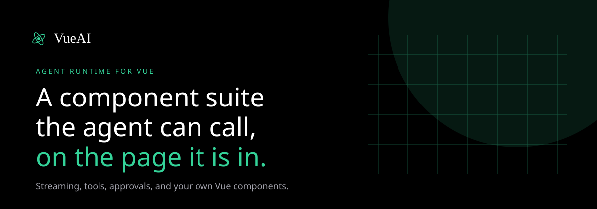
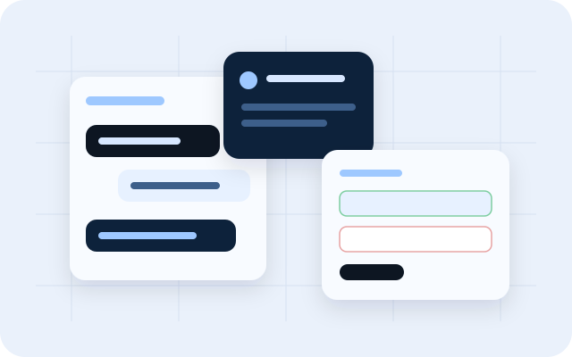
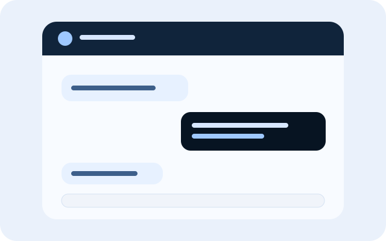
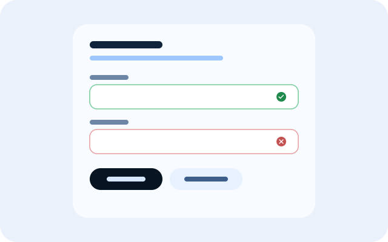
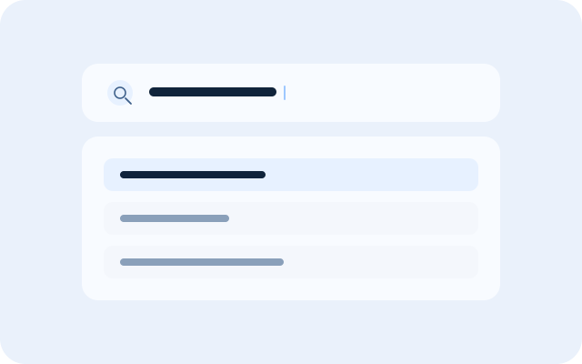
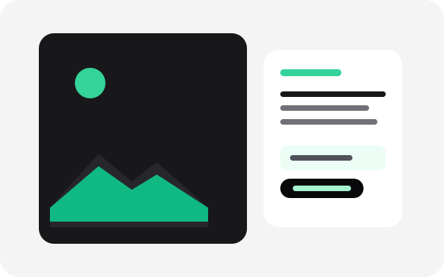
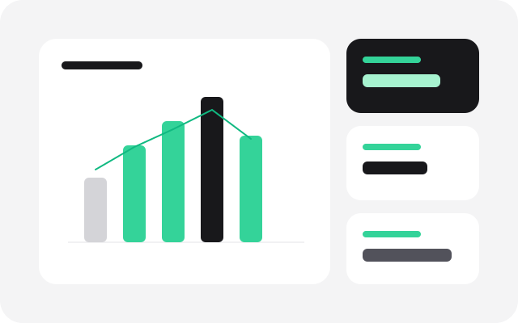

<p align="center">
  <a href="https://aivue.netlify.app">
    
  </a>
</p>

<div align="center">

  <p>
    <strong>27 production-ready AI components for Vue · Agent runtime · Vue 2 and Vue 3</strong>
  </p>

  <p>
    <a href="https://aivue.netlify.app"></a>
    <a href="https://www.npmjs.com/org/aivue"></a>
    <a href="https://github.com/reachbrt/VueAI/blob/main/LICENSE"></a>
    <a href="https://github.com/reachbrt/VueAI/stargazers"></a>
  </p>

  <p>
    
    
    
    
    
    
    
  </p>

  <p>
    <a href="https://aivue.netlify.app/"></a>
    <a href="https://github.com/reachbrt/VueAI/issues"></a>
    <a href="https://www.npmjs.com/package/@aivue/core"></a>
    <a href="https://github.com/reachbrt/VueAI/network/members"></a>
  </p>

  <p>
    <a href="https://aivue.netlify.app/" target="_blank"></a>
    <a href="#-quick-start"></a>
    <a href="https://github.com/reachbrt/VueAI/issues/new" target="_blank"></a>
  </p>

  <h3>If this project is useful, a star helps.</h3>

  <p>
    <em>Built by <a href="https://github.com/reachbrt">reachbrt</a> · Mentored by <a href="https://www.instagram.com/the_ai_dude/?hl=en">Manoj</a></em>
  </p>
</div>

## The suite

Streaming, tools, approvals, and your own Vue components, on the page the person is already using.

<table>
  <tr>
    <td width="33%">
      <br>
      <b>The suite</b><br>
      <sub>Chat, forms, and vision on one surface.</sub>
    </td>
    <td width="33%">
      <br>
      <b>Conversation</b><br>
      <sub>A thread with voice, files, and RAG.</sub>
    </td>
    <td width="33%">
      <br>
      <b>Forms</b><br>
      <sub>Validation that reads the field, not only the regex.</sub>
    </td>
  </tr>
  <tr>
    <td width="33%">
      <br>
      <b>Input</b><br>
      <sub>Suggestions beside the cursor.</sub>
    </td>
    <td width="33%">
      <br>
      <b>Vision</b><br>
      <sub>A caption, or a 360° view, from one image.</sub>
    </td>
    <td width="33%">
      <br>
      <b>Signal</b><br>
      <sub>How people and agents move through a run.</sub>
    </td>
  </tr>
</table>

### What the agent can do

| | |
| --- | --- |
| Stream the run | Tokens, reasoning, and Markdown land in the thread while the model is still writing. |
| Call the page | Tools you register can filter a table, open a document, or change the screen. |
| Wait for a person | A refund, a send, or a delete pauses on an approval. |
| Render your component | The agent places a Vue component in the thread and shares state with it. |
| Show the plan | `AiPlan` lists the steps and marks the one the run is on. |
| Cite sources | `AiSources` names the pages and records the answer came from. |
| Offer the next prompt | `AiSuggestions` sends a follow-up in one click. |
| Watch the window | `AiContext` shows how much of the context window the thread has used. |
| Remember | Hierarchical memory keeps long documents and wide tables without resending them. |
| Stay on the device | `@aivue/browser-llm` runs a model in WebGPU. No key leaves the page. |
| Write in place | Rewrite, shorten, translate, summarize, or score a draft before it is published. |
| Connect tools | `@aivue/mcp-client` talks to Model Context Protocol servers you already run. |

## 🌟 Why Choose @aivue?

<table>
<tr>
<td width="33%" align="center">

### 🎯 **Production Ready**
Battle-tested components used in real applications. Full TypeScript support, comprehensive tests, and detailed documentation.

</td>
<td width="33%" align="center">

### 🔌 **Multi-Provider**
Works with OpenAI, Claude, Gemini, Ollama, DeepSeek, and HuggingFace. Switch providers with one line of code.

</td>
<td width="33%" align="center">

### ⚡ **Easy Integration**
Install via npm, add your API key, and start building. Works with Vue 2 & 3, Nuxt, and all modern build tools.

</td>
</tr>
<tr>
<td width="33%" align="center">

### 🎨 **Customizable**
Full control over styling, behavior, and AI parameters. Built with flexibility in mind.

</td>
<td width="33%" align="center">

### 📦 **Modular**
Install only what you need. Each component is a separate package with zero dependencies on others.

</td>
<td width="33%" align="center">

### 🚀 **Active Development**
Regular updates, bug fixes, and new features. Community-driven with responsive maintainers.

</td>
</tr>
</table>

---

## 📊 Project Stats

<div align="center">

| Metric | Value |
|--------|-------|
| 📦 **Total Packages** | 27 packages |
| 🚀 **npm organization** | [@aivue](https://www.npmjs.com/org/aivue) |
| ⭐ **GitHub Stars** |  |
| 🍴 **Forks** |  |
| 📥 **npm Downloads** |  |
| 🐛 **Open Issues** |  |
| ✅ **Closed Issues** |  |
| 🔄 **Pull Requests** |  |
| 📝 **License** | MIT |
| 🏗️ **Build Status** |  |

</div>

---

## 🎬 See It In Action

<div align="center">

### 🎨 [**Live Demo**](https://aivue.netlify.app/) | 📚 [**Full Documentation**](https://github.com/reachbrt/VueAI/wiki) | 💬 [**Join Discord**](https://discord.gg/vue)

<br>

**Try the suite in the studio: live examples, code, and the agent on the page.**

[](https://aivue.netlify.app/)

</div>

---

## 🚀 Quick Start

### 📦 Installation

<table>
<tr>
<td>

```bash
# Install the core package
npm install @aivue/core

# Install component packages as needed
npm install @aivue/chatbot
npm install @aivue/autosuggest
npm install @aivue/smartform
npm install @aivue/image-caption
npm install @aivue/emotion-ui
npm install @aivue/doc-intelligence
npm install @aivue/predictive-input
npm install @aivue/smart-notify
npm install @aivue/voice-actions
npm install @aivue/analytics
npm install @aivue/smart-datatable
npm install @aivue/360-spin
npm install @aivue/browser-llm
npm install @aivue/agent
npm install @aivue/stream-markdown
npm install @aivue/writer
npm install @aivue/summarizer
npm install @aivue/translate
npm install @aivue/moderation
npm install @aivue/guided-form
npm install @aivue/mcp-client
npm install @aivue/chatbot-storage
npm install @aivue/tabular-intelligence
npm install @aivue/hierarchical-memory
npm install @aivue/ai-360-generator

# Or install the suite
npm install @aivue/core @aivue/agent @aivue/stream-markdown @aivue/chatbot @aivue/chatbot-storage @aivue/browser-llm @aivue/mcp-client @aivue/writer @aivue/summarizer @aivue/translate @aivue/moderation @aivue/smart-datatable @aivue/tabular-intelligence @aivue/hierarchical-memory @aivue/doc-intelligence @aivue/image-caption @aivue/guided-form @aivue/smartform @aivue/autosuggest @aivue/predictive-input @aivue/voice-actions @aivue/smart-notify @aivue/emotion-ui @aivue/analytics @aivue/360-spin @aivue/ai-360-generator
```

</td>
<td>

**Key Benefits:**
- 🔌 Plug-n-play Vue 3 & Nuxt support
- 🛡️ SOC2-ready AI APIs with multiple provider options
- 🌐 Works with or without API keys during development
- 🎬 YouTube + Replit templates

</td>
</tr>
</table>

### 🔑 API Key Setup

<div class="api-key-setup">
  <div class="setup-steps">
    <ol>
      <li>Create a <code>.env</code> file in your project root (this file will be automatically excluded from Git)</li>
      <li>Add your API keys for the providers you want to use:</li>
    </ol>
  </div>

  <div class="code-example">

```bash
# OpenAI API Key
VITE_OPENAI_API_KEY=your_openai_api_key_here

# Claude API Key (optional)
VITE_CLAUDE_API_KEY=your_claude_api_key_here

# Gemini API Key (optional)
VITE_GEMINI_API_KEY=your_gemini_api_key_here

# HuggingFace API Key (optional)
VITE_HUGGINGFACE_API_KEY=your_huggingface_api_key_here

# DeepSeek API Key (optional)
VITE_DEEPSEEK_API_KEY=your_deepseek_api_key_here
```

  </div>
</div>

> **Note:** If you don't have API keys, the components will still work using the fallback provider which simulates AI responses.

---

## 🏗️ Structure
```
vueai/
├── packages/
│   ├── core/              # @aivue/core
│   │   ├── src/
│   │   │   ├── index.ts
│   │   │   └── providers/
│   │   │       ├── openai.ts
│   │   │       ├── claude.ts
│   │   │       ├── gemini.ts
│   │   │       ├── huggingface.ts
│   │   │       ├── ollama.ts
│   │   │       ├── deepseek.ts
│   │   │       └── fallback.ts
│   ├── chatbot/           # @aivue/chatbot
│   ├── autosuggest/       # @aivue/autosuggest
│   ├── smartform/         # @aivue/smartform
│   ├── image-caption/     # @aivue/image-caption
│   ├── emotion-ui/        # @aivue/emotion-ui
│   ├── doc-intelligence/  # @aivue/doc-intelligence
│   ├── predictive-input/  # @aivue/predictive-input
│   ├── smart-notify/      # @aivue/smart-notify
│   ├── voice-actions/     # @aivue/voice-actions
│   ├── analytics/         # @aivue/analytics
│   ├── smart-datatable/   # @aivue/smart-datatable
│   ├── 360-spin/          # @aivue/360-spin
│   ├── browser-llm/       # @aivue/browser-llm
│   ├── agent/             # @aivue/agent
│   ├── stream-markdown/   # @aivue/stream-markdown
│   ├── cli/               # @aivue/cli
│   ├── writer/            # @aivue/writer
│   ├── summarizer/        # @aivue/summarizer
│   ├── translate/         # @aivue/translate
│   ├── moderation/        # @aivue/moderation
│   ├── guided-form/       # @aivue/guided-form
│   ├── mcp/               # @aivue/mcp-client
│   ├── chatbot-storage/   # @aivue/chatbot-storage
│   ├── tabular-intelligence/ # @aivue/tabular-intelligence
│   ├── hierarchical-memory/  # @aivue/hierarchical-memory
│   └── ai-360-generator/  # @aivue/ai-360-generator
├── demo/                  # Live demo application
└── package.json           # Root package.json with workspace configuration
```

---

## Agent runtime

The studio at [aivue.netlify.app](https://aivue.netlify.app) runs this on the page. Stream text, call a tool, and pause for a person before anything sensitive.

```bash
npm install @aivue/agent
npx @aivue/cli add agent
```

```vue
<script setup>
import { AiAgent, useAgent } from '@aivue/agent'
import '@aivue/agent/style.css'

const { messages, status, addUserMessage, play, registerTool, resolveApproval } = useAgent()

registerTool('filter_invoices', (args) => ({ status: args.status }))

async function onSend(text) {
  addUserMessage(text)
  await play([
    { type: 'RUN_STARTED' },
    { type: 'TOOL_CALL_START', id: 'filter-1', name: 'filter_invoices' },
    { type: 'TOOL_CALL_ARGS', id: 'filter-1', delta: '{"status":"overdue"}' },
    { type: 'TOOL_CALL_END', id: 'filter-1' },
    { type: 'TEXT_MESSAGE_CONTENT', delta: 'Two invoices are overdue.' },
    { type: 'RUN_FINISHED' }
  ])
}
</script>

<template>
  <AiAgent
    :messages="messages"
    :status="status"
    @send="onSend"
    @approve="resolveApproval($event, 'approved')"
    @reject="resolveApproval($event, 'rejected')"
  />
</template>
```

`@aivue/stream-markdown` renders the answer while tokens are still arriving. Unfinished code fences stay intact, and HTML from the model is escaped.

---

## 📦 Component Packages

<div class="component-cards">
  <div class="component-card">
    <div class="card-header">
      
      <h3>@aivue/chatbot <a href="https://www.npmjs.com/package/@aivue/chatbot"></a> <a href="https://www.npmjs.com/package/@aivue/chatbot"></a></h3>
    </div>
    <div class="card-features">
      <ul>
        <li>✅ Multi-provider support (OpenAI, Claude, Gemini, HuggingFace, Ollama, DeepSeek)</li>
        <li>✅ Automatic fallback when API keys aren't available</li>
        <li>✅ Streaming responses with Markdown support</li>
        <li>✅ File upload, PDF parsing, history tracking</li>
        <li>✅ "Fix with AI" feature for automatic corrections</li>
      </ul>
    </div>
    <div class="card-code">

```vue
<template>
  <AiChatWindow
    :client="aiClient"
    title="AI Assistant"
    placeholder="Ask me anything..."
    :show-avatars="true"
    theme="light"
    :streaming="true"
    :markdown="true"
    system-prompt="You are a helpful AI assistant."
  />
</template>

<script setup>
import { AIClient } from '@aivue/core';
import { AiChatWindow } from '@aivue/chatbot';
import '@aivue/chatbot/style.css';

const aiClient = new AIClient({
  provider: 'openai',
  apiKey: import.meta.env.VITE_OPENAI_API_KEY,
  model: 'gpt-6.1-sol'
});
</script>
```

  </div>
  </div>

  <div class="component-card">
    <div class="card-header">
      
      <h3>@aivue/autosuggest <a href="https://www.npmjs.com/package/@aivue/autosuggest"></a> <a href="https://www.npmjs.com/package/@aivue/autosuggest"></a></h3>
    </div>
    <div class="card-features">
      <ul>
        <li>✅ AI-powered results with semantic sort</li>
        <li>✅ Multi-provider support with automatic fallback</li>
        <li>✅ Contextual suggestions based on domain</li>
        <li>✅ Customizable UI and behavior</li>
      </ul>
    </div>
    <div class="card-code">

```vue
<template>
  <AiAutosuggest
    :client="aiClient"
    v-model="query"
    placeholder="Search..."
    :debounce="300"
    :context="'Vue.js components and libraries'"
    @select="handleSelect"
  />
</template>

<script setup>
import { ref } from 'vue';
import { AIClient } from '@aivue/core';
import { AiAutosuggest } from '@aivue/autosuggest';

const query = ref('');
const aiClient = new AIClient({
  provider: 'openai',
  apiKey: import.meta.env.VITE_OPENAI_API_KEY,
  model: 'gpt-6.1-sol'
});

function handleSelect(suggestion) {
  console.log('Selected:', suggestion);
}
</script>
```

  </div>
  </div>

  <div class="component-card">
    <div class="card-header">
      
      <h3>@aivue/smartform <a href="https://www.npmjs.com/package/@aivue/smartform"></a> <a href="https://www.npmjs.com/package/@aivue/smartform"></a></h3>
    </div>
    <div class="card-features">
      <ul>
        <li>✅ AI-powered validation + dynamic healing</li>
        <li>✅ Multi-provider support with automatic fallback</li>
        <li>✅ Intelligent form field suggestions</li>
        <li>✅ "Fix with AI" feature for automatic corrections</li>
      </ul>
    </div>
    <div class="card-code">

```vue
<template>
  <AiSmartForm
    :client="aiClient"
    :schema="formSchema"
    validation="ai"
    @submit="handleSubmit"
  />
</template>

<script setup>
import { ref } from 'vue';
import { AIClient } from '@aivue/core';
import { AiSmartForm } from '@aivue/smartform';

const aiClient = new AIClient({
  provider: 'openai',
  apiKey: import.meta.env.VITE_OPENAI_API_KEY
});

const formSchema = ref({
  fields: [
    {
      name: 'email',
      label: 'Email',
      type: 'email',
      required: true
    },
    {
      name: 'description',
      label: 'Description',
      type: 'textarea',
      required: true,
      minLength: 50
    }
  ]
});

function handleSubmit(data) {
  console.log('Form submitted:', data);
}
</script>
```

  </div>
  </div>

  <div class="component-card">
    <div class="card-header">
      
      <h3>@aivue/image-caption <a href="https://www.npmjs.com/package/@aivue/image-caption"></a> <a href="https://www.npmjs.com/package/@aivue/image-caption"></a></h3>
    </div>
    <div class="card-features">
      <ul>
        <li>✅ OpenAI Vision models (GPT-4o, GPT-4o Mini, GPT-4 Turbo)</li>
        <li>✅ Drag & drop image upload with preview</li>
        <li>✅ URL support for remote images</li>
        <li>✅ Batch processing for multiple images</li>
        <li>✅ History tracking and export functionality</li>
      </ul>
    </div>
    <div class="card-code">

```vue
<template>
  <AiImageCaption
    :api-key="apiKey"
    :model="'gpt-6.1-sol'"
    @caption-generated="handleCaption"
    @caption-error="handleError"
  />
</template>

<script setup>
import { AiImageCaption } from '@aivue/image-caption';
import '@aivue/image-caption/dist/image-caption.css';

const apiKey = import.meta.env.VITE_OPENAI_API_KEY;

function handleCaption(result) {
  console.log('Generated caption:', result.caption);
}

function handleError(error) {
  console.error('Caption error:', error);
}
</script>
```

  </div>
  </div>

  <div class="component-card">
    <div class="card-header">
      
      <h3>@aivue/analytics <a href="https://www.npmjs.com/package/@aivue/analytics"></a> <a href="https://www.npmjs.com/package/@aivue/analytics"></a></h3>
    </div>
    <div class="card-features">
      <ul>
        <li>✅ Real-time analytics and insights dashboard</li>
        <li>✅ AI-powered conversation analysis</li>
        <li>✅ Performance monitoring and error tracking</li>
        <li>✅ Beautiful charts and visualizations</li>
        <li>✅ Privacy-first with local storage by default</li>
      </ul>
    </div>
    <div class="card-code">

```vue
<template>
  <div>
    <!-- Analytics Dashboard -->
    <AiAnalyticsDashboard
      :ai-client="aiClient"
      :show-conversation-analytics="true"
    />

    <!-- Track interactions automatically -->
    <button v-analytics="{ component: 'my-app', action: 'click' }">
      Click me
    </button>
  </div>
</template>

<script setup>
import { AiAnalyticsDashboard, useAnalytics, vAnalytics } from '@aivue/analytics';
import { AIClient } from '@aivue/core';

const aiClient = new AIClient({
  provider: 'openai',
  apiKey: import.meta.env.VITE_OPENAI_API_KEY
});

// Set up analytics
const analytics = useAnalytics({
  config: { enabled: true, trackInteractions: true },
  aiClient
});
</script>
```

  </div>
  </div>

  <div class="component-card">
    <div class="card-header">
      
      <h3>@aivue/emotion-ui <a href="https://www.npmjs.com/package/@aivue/emotion-ui"></a> <a href="https://www.npmjs.com/package/@aivue/emotion-ui"></a></h3>
    </div>
    <div class="card-features">
      <ul>
        <li>✅ Real-time emotion detection from text input</li>
        <li>✅ Sentiment analysis with AI-powered insights</li>
        <li>✅ Emotion-aware UI components (inputs, buttons, notifications)</li>
        <li>✅ Adaptive styling based on detected emotions</li>
        <li>✅ Facial and voice analysis support</li>
      </ul>
    </div>
    <div class="card-code">

```vue
<template>
  <div>
    <EmotionAwareInput
      v-model="message"
      placeholder="Type your message..."
      @emotion-detected="handleEmotion"
    />
    <EmotionAwareButton
      :emotion="currentEmotion"
      @click="handleSubmit"
    >
      Send Message
    </EmotionAwareButton>
  </div>
</template>

<script setup>
import { ref } from 'vue';
import { EmotionAwareInput, EmotionAwareButton, useEmotionStore } from '@aivue/emotion-ui';
import '@aivue/emotion-ui/style.css';

const message = ref('');
const emotionStore = useEmotionStore();
const currentEmotion = computed(() => emotionStore.currentEmotion);

function handleEmotion(emotion) {
  console.log('Detected emotion:', emotion);
}

function handleSubmit() {
  console.log('Message:', message.value);
}
</script>
```

  </div>
  </div>

  <div class="component-card">
    <div class="card-header">
      
      <h3>@aivue/doc-intelligence <a href="https://www.npmjs.com/package/@aivue/doc-intelligence"></a> <a href="https://www.npmjs.com/package/@aivue/doc-intelligence"></a></h3>
    </div>
    <div class="card-features">
      <ul>
        <li>✅ OCR text extraction from PDFs and images</li>
        <li>✅ Document type detection (invoice, receipt, ID, etc.)</li>
        <li>✅ Entity extraction (dates, amounts, emails, etc.)</li>
        <li>✅ Auto-generated forms from extracted data</li>
        <li>✅ Support for multiple document formats</li>
      </ul>
    </div>
    <div class="card-code">

```vue
<template>
  <div>
    <DocumentUpload
      @document-uploaded="handleUpload"
      :accepted-types="['pdf', 'jpg', 'png']"
    />
    <DocumentViewer
      v-if="document"
      :document="document"
      :extracted-text="extractedText"
    />
    <ExtractedDataForm
      v-if="extractedData"
      :data="extractedData"
      @submit="handleSubmit"
    />
  </div>
</template>

<script setup>
import { ref } from 'vue';
import { DocumentUpload, DocumentViewer, ExtractedDataForm, useDocIntelligence } from '@aivue/doc-intelligence';
import '@aivue/doc-intelligence/style.css';

const document = ref(null);
const { extractText, detectDocumentType, extractEntities } = useDocIntelligence();

async function handleUpload(file) {
  document.value = file;
  const text = await extractText(file);
  const type = await detectDocumentType(text);
  const entities = await extractEntities(text, type);
  console.log('Extracted:', { text, type, entities });
}
</script>
```

  </div>
  </div>

  <div class="component-card">
    <div class="card-header">
      
      <h3>@aivue/predictive-input <a href="https://www.npmjs.com/package/@aivue/predictive-input"></a> <a href="https://www.npmjs.com/package/@aivue/predictive-input"></a></h3>
    </div>
    <div class="card-features">
      <ul>
        <li>✅ AI-powered text predictions and completions</li>
        <li>✅ Context-aware suggestions</li>
        <li>✅ Multiple prediction modes (email, creative, code, etc.)</li>
        <li>✅ Pattern learning from user behavior</li>
        <li>✅ Offline n-gram model support</li>
      </ul>
    </div>
    <div class="card-code">

```vue
<template>
  <PredictiveInput
    v-model="text"
    :ai-client="aiClient"
    :mode="'email'"
    :show-predictions="true"
    @prediction-accepted="handlePrediction"
  />
</template>

<script setup>
import { ref } from 'vue';
import { AIClient } from '@aivue/core';
import { PredictiveInput } from '@aivue/predictive-input';
import '@aivue/predictive-input/style.css';

const text = ref('');
const aiClient = new AIClient({
  provider: 'openai',
  apiKey: import.meta.env.VITE_OPENAI_API_KEY
});

function handlePrediction(prediction) {
  console.log('Accepted prediction:', prediction);
}
</script>
```

  </div>
  </div>

  <div class="component-card">
    <div class="card-header">
      
      <h3>@aivue/smart-datatable <a href="https://www.npmjs.com/package/@aivue/smart-datatable"></a> <a href="https://www.npmjs.com/package/@aivue/smart-datatable"></a></h3>
    </div>
    <div class="card-features">
      <ul>
        <li>✅ Natural language search with AI</li>
        <li>✅ Chat can execute filter commands</li>
        <li>✅ Auto-insights and summaries</li>
        <li>✅ Row-level AI agents</li>
        <li>✅ AI-powered data transformations</li>
        <li>✅ Smart type conversion and filtering</li>
      </ul>
    </div>
    <div class="card-code">

```vue
<template>
  <SmartDataTable
    :data="products"
    :columns="columns"
    :ai-client="aiClient"
    :ai-search="true"
    :ai-insights="true"
    :show-chat="true"
    title="Products"
    :pagination="true"
    :selectable="true"
  />
</template>

<script setup>
import { AIClient } from '@aivue/core';
import { SmartDataTable } from '@aivue/smart-datatable';
import '@aivue/smart-datatable/style.css';

const aiClient = new AIClient({
  provider: 'openai',
  apiKey: import.meta.env.VITE_OPENAI_API_KEY,
  model: 'gpt-6.1-sol'
});

const products = ref([
  { id: 1, name: 'Product A', price: 99.99, category: 'Electronics' },
  { id: 2, name: 'Product B', price: 149.99, category: 'Clothing' }
]);

const columns = [
  { key: 'id', label: 'ID', sortable: true },
  { key: 'name', label: 'Name', sortable: true },
  { key: 'price', label: 'Price', sortable: true },
  { key: 'category', label: 'Category', sortable: true }
];
</script>
```

  </div>
  </div>

  <div class="component-card">
    <div class="card-header">
      
      <h3>@aivue/360-spin <a href="https://www.npmjs.com/package/@aivue/360-spin"></a> <a href="https://www.npmjs.com/package/@aivue/360-spin"></a></h3>
    </div>
    <div class="card-features">
      <ul>
        <li>✅ True 360° product rotation</li>
        <li>✅ Frame sequence support</li>
        <li>✅ GIF animation support</li>
        <li>✅ Mobile drag-to-spin</li>
        <li>✅ Auto-play and hover triggers</li>
        <li>✅ Image preloading</li>
      </ul>
    </div>
    <div class="card-code">

```vue
<template>
  <Ai360Spin
    :images="productImages"
    :frame-count="36"
    :auto-play="true"
    :loop="true"
    :speed="100"
    width="600px"
    height="600px"
  />
</template>

<script setup>
import { ref } from 'vue';
import { Ai360Spin } from '@aivue/360-spin';
import '@aivue/360-spin/style.css';

const productImages = ref([
  '/images/product-001.jpg',
  '/images/product-002.jpg',
  '/images/product-003.jpg',
  // ... 36 frames total
]);
</script>
```

  </div>
  </div>

  <div class="component-card">
    <div class="card-header">
      
      <h3>@aivue/browser-llm <a href="https://www.npmjs.com/package/@aivue/browser-llm"></a> <a href="https://www.npmjs.com/package/@aivue/browser-llm"></a></h3>
    </div>
    <div class="card-features">
      <ul>
        <li>✅ Run AI models locally in the browser with WebGPU</li>
        <li>✅ No API keys required - 100% private and offline</li>
        <li>✅ Multiple models (Llama, Qwen, Phi, Gemma, etc.)</li>
        <li>✅ Streaming chat responses with real-time generation</li>
        <li>✅ Model download progress tracking</li>
        <li>✅ WebGPU acceleration for fast inference</li>
      </ul>
    </div>
    <div class="card-code">

```vue
<template>
  <div>
    <ModelSelector
      :available-models="availableModels"
      :current-model="currentModel"
      :is-loading="isLoading"
      :download-progress="downloadProgress"
      @load-model="loadModel"
    />

    <BrowserLLMChat
      v-if="isModelLoaded"
      :messages="messages"
      :is-model-loaded="isModelLoaded"
      :is-loading="isLoading"
      :current-model="currentModel"
      @stream-message="handleStreamMessage"
    />
  </div>
</template>

<script setup>
import { useBrowserLLM, ModelSelector, BrowserLLMChat } from '@aivue/browser-llm';
import '@aivue/browser-llm/dist/browser-llm.css';

const {
  availableModels,
  loadModel,
  messages,
  streamMessage,
  isModelLoaded,
  isLoading,
  downloadProgress,
  currentModel,
} = useBrowserLLM({
  defaultModel: 'Llama-3.2-1B-Instruct-q4f16_1-MLC',
  temperature: 0.7,
});

async function handleStreamMessage(content) {
  for await (const chunk of streamMessage(content)) {
    // Streaming handled automatically
  }
}
</script>
```

  </div>
  </div>

---

  <div class="component-card">
    <div class="card-header">
      
      <h3>@aivue/agent <a href="https://www.npmjs.com/package/@aivue/agent"></a></h3>
    </div>
    <div class="card-features">
      <ul>
        <li>✅ Stream text, reasoning, and tool calls into one thread</li>
        <li>✅ Register tools that can change the page the user is looking at</li>
        <li>✅ Pause for approval before a refund, a send, or a delete</li>
        <li>✅ Render a Vue component the agent selects, and share state with it</li>
      </ul>
    </div>
    <div class="card-code">

```vue
<script setup>
import { AiAgent, useAgent } from '@aivue/agent';
import '@aivue/agent/style.css';

const { messages, status, addUserMessage, play } = useAgent();
</script>

<template>
  <AiAgent :messages="messages" :status="status" @send="addUserMessage" />
</template>
```

    </div>
  </div>


  <div class="component-card">
    <div class="card-header">
      
      <h3>@aivue/writer <a href="https://www.npmjs.com/package/@aivue/writer"></a></h3>
    </div>
    <div class="card-features">
      <ul>
        <li>✅ Rewrite, shorten, expand, fix grammar, change tone, and continue</li>
        <li>✅ Works in place on the text the user is already editing</li>
        <li>✅ Same provider client as the rest of the suite</li>
      </ul>
    </div>
    <div class="card-code">

```vue
<script setup>
import { ref } from 'vue';
import { AIClient } from '@aivue/core';
import { AiWriter } from '@aivue/writer';

const draft = ref('Paste a paragraph here.');
const client = new AIClient({ provider: 'openai', apiKey: import.meta.env.VITE_OPENAI_API_KEY });
</script>

<template>
  <AiWriter v-model="draft" :client="client" />
</template>
```

    </div>
  </div>


  <div class="component-card">
    <div class="card-header">
      
      <h3>@aivue/summarizer <a href="https://www.npmjs.com/package/@aivue/summarizer"></a></h3>
    </div>
    <div class="card-features">
      <ul>
        <li>✅ Short, medium, or long summaries</li>
        <li>✅ Paragraph, bullets, or a plain explanation</li>
        <li>✅ Composable when you do not want the built-in panel</li>
      </ul>
    </div>
    <div class="card-code">

```vue
<template>
  <AiSummarizer v-model="text" :client="client" length="medium" summary-style="paragraph" />
</template>
```

    </div>
  </div>


  <div class="component-card">
    <div class="card-header">
      
      <h3>@aivue/translate <a href="https://www.npmjs.com/package/@aivue/translate"></a></h3>
    </div>
    <div class="card-features">
      <ul>
        <li>✅ Detect the source language or set it yourself</li>
        <li>✅ Translate into a target language</li>
        <li>✅ Switch formality when the language supports it</li>
      </ul>
    </div>
    <div class="card-code">

```vue
<template>
  <AiTranslate v-model="text" :client="client" source-lang="auto" target-lang="es" />
</template>
```

    </div>
  </div>


  <div class="component-card">
    <div class="card-header">
      
      <h3>@aivue/moderation <a href="https://www.npmjs.com/package/@aivue/moderation"></a></h3>
    </div>
    <div class="card-features">
      <ul>
        <li>✅ Score a draft for hate, harassment, sexual content, violence, self-harm, and spam</li>
        <li>✅ Threshold you choose before publish</li>
        <li>✅ A lightweight heuristic when no API client is configured</li>
      </ul>
    </div>
    <div class="card-code">

```vue
<template>
  <AiModeration v-model="text" :client="client" :threshold="0.5" />
</template>
```

    </div>
  </div>


  <div class="component-card">
    <div class="card-header">
      
      <h3>@aivue/guided-form <a href="https://www.npmjs.com/package/@aivue/guided-form"></a></h3>
    </div>
    <div class="card-features">
      <ul>
        <li>✅ One question at a time from a schema</li>
        <li>✅ Hints, examples, and validation beside the field</li>
        <li>✅ Save and resume, conditional steps, Vue 2 and Vue 3</li>
      </ul>
    </div>
    <div class="card-code">

```vue
<template>
  <AiGuidedForm :schema="schema" :client="client" @complete="onComplete" />
</template>
```

    </div>
  </div>


  <div class="component-card">
    <div class="card-header">
      
      <h3>@aivue/mcp-client <a href="https://www.npmjs.com/package/@aivue/mcp-client"></a></h3>
    </div>
    <div class="card-features">
      <ul>
        <li>✅ Connect the page to Model Context Protocol servers</li>
        <li>✅ Tools and resources over the standard client flow</li>
        <li>✅ Use the tools from the agent or from your own UI</li>
      </ul>
    </div>
    <div class="card-code">

```vue
<script setup>
import { AiMcpClient } from '@aivue/mcp-client';
</script>
```

    </div>
  </div>


  <div class="component-card">
    <div class="card-header">
      
      <h3>@aivue/tabular-intelligence <a href="https://www.npmjs.com/package/@aivue/tabular-intelligence"></a></h3>
    </div>
    <div class="card-features">
      <ul>
        <li>✅ Statistics, charts, and models over rows you already have</li>
        <li>✅ Profiling, cleaning, and feature ideas</li>
        <li>✅ Separate from the data table: this package analyzes, the table displays</li>
      </ul>
    </div>
    <div class="card-code">

```vue
<template>
  <AiTabularIntelligence :rows="rows" />
</template>
```

    </div>
  </div>


  <div class="component-card">
    <div class="card-header">
      
      <h3>@aivue/hierarchical-memory <a href="https://www.npmjs.com/package/@aivue/hierarchical-memory"></a></h3>
    </div>
    <div class="card-features">
      <ul>
        <li>✅ Memory trees for long documents and wide tables</li>
        <li>✅ Retrieve a slice instead of sending the whole source</li>
      </ul>
    </div>
    <div class="card-code">

```vue
<script setup>
import { AiHierarchicalMemory } from '@aivue/hierarchical-memory';
</script>
```

    </div>
  </div>


  <div class="component-card">
    <div class="card-header">
      
      <h3>@aivue/chatbot-storage <a href="https://www.npmjs.com/package/@aivue/chatbot-storage"></a></h3>
    </div>
    <div class="card-features">
      <ul>
        <li>✅ Persist chatbot threads so a reload does not wipe the conversation</li>
        <li>✅ Adapters for the storage you already use</li>
      </ul>
    </div>
    <div class="card-code">

```bash
npm install @aivue/chatbot-storage @aivue/chatbot
```

    </div>
  </div>


  <div class="component-card">
    <div class="card-header">
      
      <h3>@aivue/ai-360-generator <a href="https://www.npmjs.com/package/@aivue/ai-360-generator"></a></h3>
    </div>
    <div class="card-features">
      <ul>
        <li>✅ Build a 360° product view from a single image</li>
        <li>✅ Pairs with @aivue/360-spin for the turntable</li>
      </ul>
    </div>
    <div class="card-code">

```vue
<template>
  <Ai360Generator @frames="onFrames" />
</template>
```

    </div>
  </div>


  <div class="component-card">
    <div class="card-header">
      
      <h3>@aivue/smart-notify <a href="https://www.npmjs.com/package/@aivue/smart-notify"></a></h3>
    </div>
    <div class="card-features">
      <ul>
        <li>✅ Group related notifications</li>
        <li>✅ Time them to attention instead of stacking every event</li>
      </ul>
    </div>
    <div class="card-code">

```vue
<template>
  <AiSmartNotify />
</template>
```

    </div>
  </div>


  <div class="component-card">
    <div class="card-header">
      
      <h3>@aivue/voice-actions <a href="https://www.npmjs.com/package/@aivue/voice-actions"></a></h3>
    </div>
    <div class="card-features">
      <ul>
        <li>✅ Turn speech into commands the page can run</li>
        <li>✅ Map phrases to the actions you register</li>
      </ul>
    </div>
    <div class="card-code">

```vue
<template>
  <AiVoiceActions :actions="actions" />
</template>
```

    </div>
  </div>


  <div class="component-card">
    <div class="card-header">
      
      <h3>@aivue/stream-markdown <a href="https://www.npmjs.com/package/@aivue/stream-markdown"></a></h3>
    </div>
    <div class="card-features">
      <ul>
        <li>✅ Render Markdown while the model is still typing</li>
        <li>✅ Unfinished fences and emphasis do not flicker</li>
        <li>✅ HTML from the model is escaped</li>
      </ul>
    </div>
    <div class="card-code">

```vue
<template>
  <AiStreamMarkdown :source="source" />
</template>
```

    </div>
  </div>


  <div class="component-card">
    <div class="card-header">
      
      <h3>@aivue/cli <a href="https://www.npmjs.com/package/@aivue/cli"></a></h3>
    </div>
    <div class="card-features">
      <ul>
        <li>✅ aivue add agent writes an agent panel into your app</li>
        <li>✅ aivue add nuxt writes the Nuxt plugin</li>
        <li>✅ Pass --force to replace a file that is already there</li>
      </ul>
    </div>
    <div class="card-code">

```bash
npx @aivue/cli add agent
npx @aivue/cli add nuxt
```

    </div>
  </div>


## 🧠 @aivue/core Shared AI Engine

<div class="component-card core-card">
  <div class="card-header">
    
    <h3>@aivue/core <a href="https://www.npmjs.com/package/@aivue/core"></a> <a href="https://www.npmjs.com/package/@aivue/core"></a></h3>
  </div>
  <div class="card-description">
    <p>Our core package provides a unified interface for working with multiple AI providers, complete with an automatic fallback mechanism that ensures your components work even without API keys.</p>
  </div>
  <div class="card-features">
    <ul>
      <li>✅ Multi-provider support (OpenAI, Claude, Gemini, HuggingFace, Ollama, DeepSeek)</li>
      <li>✅ Bearer token authentication for remote Ollama instances</li>
      <li>✅ Automatic fallback when API keys aren't available</li>
      <li>✅ Unified API for chat, embeddings, and validation</li>
      <li>✅ TypeScript support with comprehensive type definitions</li>
    </ul>
  </div>
  <div class="card-code">

```ts
import { AIClient } from '@aivue/core';

// Create a client with your preferred provider
const client = new AIClient({
  provider: 'openai', // or 'claude', 'gemini', 'huggingface', 'ollama', 'deepseek'
  apiKey: import.meta.env.VITE_OPENAI_API_KEY, // Optional - falls back to simulation if missing
  model: 'gpt-6.1-sol' // Optional - uses provider's default if missing
});

// Chat functionality
const response = await client.chat([
  { role: 'user', content: 'Hello, can you help me with Vue.js?' }
]);

// Embeddings for semantic search
const embeddings = await client.embeddings('How do I create a component?');

// Form field validation
const validation = await client.validateFormField(
  'email',
  'user@example',
  ['email', 'required']
);

// Complete text (for autosuggest)
const completion = await client.complete('How do I install Vue', {
  maxTokens: 100
});
```

  </div>
</div>

---

## 🛡️ Fallback Mechanism

<div class="feature-section fallback-section">
  <div class="feature-content">
    <h3>Develop Without API Keys</h3>
    <p>All VueAI components include an intelligent fallback system when API keys aren't available:</p>

    <ul class="feature-list">
      <li>🔍 Automatically detects missing API keys</li>
      <li>🤖 Provides simulated responses that match the expected shape</li>
      <li>💡 Generates semantically reasonable suggestions</li>
      <li>🚀 Delivers smooth user experience during development</li>
      <li>🔄 Works with all supported providers seamlessly</li>
    </ul>
  </div>

  <div class="feature-image">
    
  </div>
</div>

## 🧪 Testing & Development

<div class="code-tabs">
  <div class="tab">
    <div class="tab-header">Testing Setup</div>
    <div class="tab-content">

```bash
npm install vitest @vue/test-utils --save-dev
```

```ts
// chatbot/tests/AiChatWindow.spec.ts
test('sends messages', async () => {
  const wrapper = mount(AiChatWindow);
  await wrapper.find('input').setValue('Hi');
  await wrapper.find('input').trigger('keyup.enter');
  expect(wrapper.emitted()).toHaveProperty('send');
});
```

  </div>
  </div>

  <div class="tab">
    <div class="tab-header">Build & Publish</div>
    <div class="tab-content">

```bash
# Build all packages
npm run build:packages

# Publish packages
npm publish --access public --workspace @aivue/core
npm publish --access public --workspace @aivue/chatbot
npm publish --access public --workspace @aivue/autosuggest
npm publish --access public --workspace @aivue/smartform
npm publish --access public --workspace @aivue/image-caption
npm publish --access public --workspace @aivue/emotion-ui
npm publish --access public --workspace @aivue/doc-intelligence
npm publish --access public --workspace @aivue/predictive-input
npm publish --access public --workspace @aivue/smart-notify
npm publish --access public --workspace @aivue/voice-actions
npm publish --access public --workspace @aivue/analytics
npm publish --access public --workspace @aivue/smart-datatable
npm publish --access public --workspace @aivue/360-spin

# Or use the publish script
npm run publish:packages
```

  </div>
  </div>
</div>

## 📚 Resources

<div class="resources-grid">
  <a href="https://aivue.netlify.app/" class="resource-card" target="_blank">
    <div class="resource-icon">📺</div>
    <div class="resource-content">
      <h4>Live Demo</h4>
      <p>Interactive demo of all components</p>
    </div>
  </a>

  <a href="https://github.com/reachbrt/VueAI/wiki" class="resource-card" target="_blank">
    <div class="resource-icon">📚</div>
    <div class="resource-content">
      <h4>Documentation Wiki</h4>
      <p>Comprehensive guides and API references</p>
    </div>
  </a>

  <a href="https://github.com/reachbrt/VueAI/wiki/Contributing" class="resource-card" target="_blank">
    <div class="resource-icon">🤝</div>
    <div class="resource-content">
      <h4>Contributing Guide</h4>
      <p>Help improve VueAI components</p>
    </div>
  </a>

  <a href="https://github.com/reachbrt/VueAI/issues/new" class="resource-card" target="_blank">
    <div class="resource-icon">🐛</div>
    <div class="resource-content">
      <h4>Report Issues</h4>
      <p>Submit bugs or feature requests</p>
    </div>
  </a>
</div>

## 🎯 Showcase

<div align="center">

### 🌟 **Who's Using @aivue?**

Are you using @aivue in your project? [**Add your project here!**](https://github.com/reachbrt/VueAI/issues/new?title=Showcase:%20My%20Project)

<table>
<tr>
<td align="center" width="25%">
<br>
<strong>Your Project</strong><br>
<small>Be the first to showcase!</small>
</td>
<td align="center" width="25%">
<br>
<strong>Your Project</strong><br>
<small>Share your success story</small>
</td>
<td align="center" width="25%">
<br>
<strong>Your Project</strong><br>
<small>Join our showcase</small>
</td>
<td align="center" width="25%">
<br>
<strong>Your Project</strong><br>
<small>Feature your work</small>
</td>
</tr>
</table>

</div>

---

## 🤝 Community & Support

<div align="center">

### 💬 **Join Our Community**

<table>
<tr>
<td align="center" width="25%">

[](https://discord.gg/vue)

**Discord**<br>
Chat with the community

</td>
<td align="center" width="25%">

[](https://github.com/reachbrt/VueAI/discussions)

**Discussions**<br>
Ask questions & share ideas

</td>
<td align="center" width="25%">

[](https://twitter.com/intent/follow?screen_name=reachbrt)

**Twitter**<br>
Get latest updates

</td>
<td align="center" width="25%">

[](https://www.linkedin.com/in/bharatkumarsubramanian/)

**LinkedIn**<br>
Professional network

</td>
</tr>
</table>

### 📢 **Stay Updated**

- 🌟 **Star this repo** to get notifications about new releases
- 👀 **Watch** for updates on issues and pull requests
- 🔔 **Follow** [@reachbrt](https://github.com/reachbrt) on GitHub
- 📧 **Subscribe** to our [newsletter](https://github.com/reachbrt/VueAI/discussions) (coming soon!)

</div>

---

## 🎁 Support This Project

<div align="center">

If you find @aivue useful, please consider supporting the project:

<table>
<tr>
<td align="center" width="33%">

### ⭐ **Star on GitHub**
Give us a star to show your support!

[](https://github.com/reachbrt/VueAI/stargazers)

</td>
<td align="center" width="33%">

### 💖 **Sponsor**
Support ongoing development

[](https://github.com/sponsors/reachbrt)

</td>
<td align="center" width="33%">

### 🐦 **Share**
Spread the word!

[](https://twitter.com/intent/tweet?text=Check%20out%20@aivue%20-%2016%20AI-powered%20Vue.js%20components!&url=https://github.com/reachbrt/VueAI)

</td>
</tr>
</table>

### 🙏 **Other Ways to Support**

- 📝 Write a blog post or tutorial about @aivue
- 🎥 Create a video tutorial on YouTube
- 💬 Answer questions in [Discussions](https://github.com/reachbrt/VueAI/discussions)
- 🐛 Report bugs and suggest features
- 🔧 Contribute code improvements
- 📚 Improve documentation
- 🌍 Translate documentation to other languages

</div>

---

## 🏆 Contributors

<div align="center">

### 👥 **Thanks to all contributors!**

<a href="https://github.com/reachbrt/VueAI/graphs/contributors">
  
</a>

**Want to contribute?** Check out our [Contributing Guide](https://github.com/reachbrt/VueAI/wiki/Contributing)!

</div>

---

## 📊 Repository Stats

<div align="center">


<table>
<tr>
<td align="center">


**Commit Activity**

</td>
<td align="center">


**Last Commit**

</td>
<td align="center">


**Contributors**

</td>
</tr>
<tr>
<td align="center">


**Code Size**

</td>
<td align="center">


**Repo Size**

</td>
<td align="center">


**Languages**

</td>
</tr>
</table>

</div>

---

## 📄 License

<div align="center">

**MIT License** © 2025 [Bharatkumar Subramanian](https://github.com/reachbrt)

[](https://github.com/reachbrt/VueAI/blob/main/LICENSE)

This project is licensed under the MIT License - see the [LICENSE](LICENSE) file for details.

### 👨‍💻 **Author & Maintainer**

<table>
<tr>
<td align="center">
<br>
<strong>Bharatkumar Subramanian</strong><br>
<a href="https://github.com/reachbrt">GitHub</a> •
<a href="https://www.linkedin.com/in/bharatkumarsubramanian/">LinkedIn</a> •
<a href="mailto:reachbrt@gmail.com">Email</a>
</td>
</tr>
</table>

### 🙏 **Special Thanks**

Huge gratitude to my mentor who guided me through this journey:

- **[Manoj (@the_ai_dude)](https://www.instagram.com/the_ai_dude/?hl=en)** - Main guidance and mentorship

</div>

---

## ⭐ Star History

<div align="center">

[](https://star-history.com/#reachbrt/VueAI&Date)

</div>

---

## 🔗 Related Projects

<div align="center">

Interested in AI components for other frameworks?

| Framework | Repository | Status |
|-----------|-----------|--------|
| **Angular** | [angularai](https://github.com/reachbrt/angularai) | 🚧 Coming Soon |
| **React** | [reactai](https://github.com/reachbrt/reactai) | 💡 Planned |
| **Svelte** | [svelteai](https://github.com/reachbrt/svelteai) | 💡 Planned |

</div>

---

<div align="center">

### 🎉 **Thank you for using @aivue!**

<p>
  <strong>If this project helped you, please consider:</strong><br>
  ⭐ Starring the repository<br>
  🐦 Sharing on social media<br>
  💖 Sponsoring the project<br>
  🤝 Contributing to the codebase
</p>

<p>
  <em>Made with ❤️ by <a href="https://github.com/reachbrt">reachbrt</a></em>
</p>

---

**[⬆ Back to Top](#-vueai---modern-ai-components-for-vuejs)**

</div>